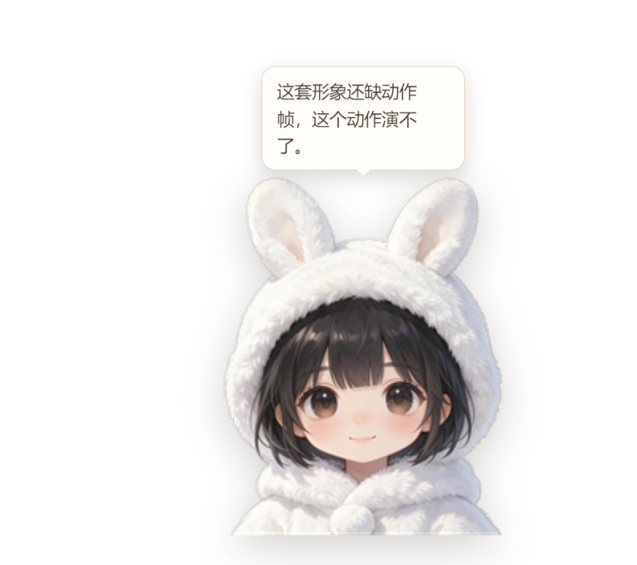
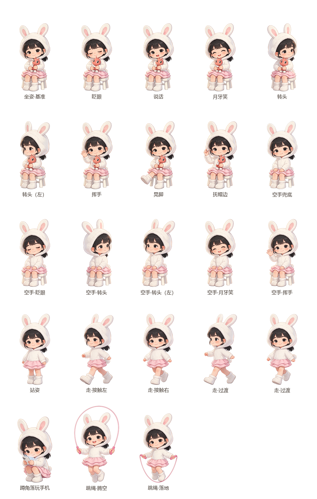
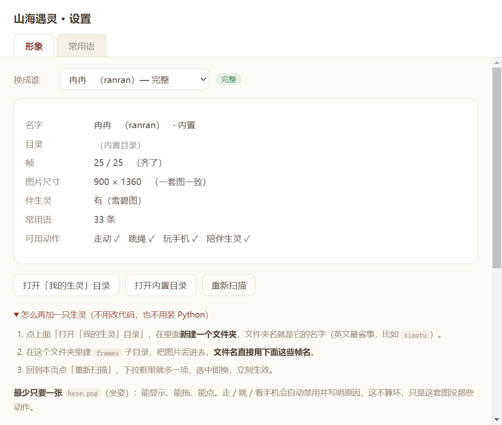

# 山海遇灵

> 主仓库 GitHub：<https://github.com/cn-zhangpeng/shanhai-yuling> ｜ 国内镜像 Gitee：<https://gitee.com/cn-zhangpeng/shanhai-yuling>

一个跑在 Windows 桌面上的陪伴生灵。**应用名就叫“山海遇灵”**——以后还会加别的桌面生灵，冉冉只是现在这一只：照着自家小朋友画的 Q 版小人（刺绣兔耳帽 + 白毛绒玩偶服 + 粉裙 + 白靴），伴生灵是一只珊瑚粉小蚂蚁——它是活物，不是布偶。

她不占任务栏、不抢焦点，透明置顶贴在桌面右下角：坐着会有安静的小动作，会站起来陪蚂蚁玩，会走两步、跳绳、躲到角落偷偷玩手机；点不到她的时候就锁定，让鼠标直接穿到底下的窗口。

> 当前跑的是 **Electron 过渡壳**（`desktop-shell/`，electron@33）。最终形态是 **Tauri 2 + Live2D**，先用电子的性能跑通动作与交互，避免在绑定工具链上反复返工。

## 长什么样

<p align="center"></p>

<p align="center"></p>

25 个动作帧全在这张图上（少帧时她会直接说“演不了”，不会硬演）：

<p align="center"></p>

设置页（形象 / 常用语）：

<p align="center">
  
  
</p>

---

## 目录结构

```
shanhai-yuling/
├─ desktop-shell/          Electron 桌宠本体（当前主力）
│  ├─ main.js              主进程：窗口/穿透/拖拽/平移缓动/缩放/钉住/锁定/菜单/快捷键/开机自启 + 生灵包扫描与 pet:// 协议
│  ├─ creature-pack.js     生灵包注册表：扫目录 → 按文件名认帧 → 量头顶锚点 → 拼 pet:// 地址
│  ├─ lib/manifest.js      清单 v2 校验 + 默认轨道合成（v1 清单自动补齐，纯 Node 可单测）
│  ├─ lib/pet-state.js     帧轨道播放器（帧序/时长/循环/回落/序列，浏览器与 Node 共用）
│  ├─ settings-store.js    %APPDATA%\山海遇灵\settings.json 的读写（当前形象 + 常用语覆盖）
│  ├─ settings.html        设置窗口：形象（下拉框）/ 常用语（表格）两页
│  ├─ settings-preload.js  设置窗口的 contextBridge 白名单
│  ├─ preload.js           桌宠窗口的 contextBridge 白名单
│  ├─ desk-pet.html        渲染层：按载荷注入帧 + 双精灵 + 气泡 + 场景脚本（约 1000 行）
│  ├─ tests/               冒烟自检（smoke-creature.js，Electron 跑）+ 单元测试（node 直跑）
│  ├─ assets/              原始素材种子（只读）：25 张成品帧（ranran_*_2x.png，900×1360）+ ant_walk.png 九格雪碧图 + creature.json + lines.json + icon/
│  │                        首次启动复制成「生灵目录\冉冉\」，运行时不再读这里
│  └─ README.md            渲染层与主进程的行为说明、参数真值、调试开关
├─ tools/                  构建与验收脚本（Python，标准库为主）
│  ├─ build_portable.py    组装绿色版 exe + zip（不依赖 electron-builder / NSIS）
│  ├─ build_installer.py   打 Windows 安装包（NSIS，可选安装位置 + 卸载项 + 快捷方式）
│  ├─ build_app_icon.py    头肩图标 → 多尺寸 png + 多尺寸 ico
│  ├─ check_creature.py    生灵包自检：帧齐不齐、透明底、脚底基线、伴生灵切帧（`--scan` 全扫，需 Python，可选）
│  ├─ fix_walk_baseline.py 走路 4 帧整体下移 111px 对齐脚底基线（原图备份在 assets\_before_walkfix2）
│  ├─ shot_window.py       PrintWindow 按 DPI 抓真实窗口画面
│  ├─ sample_move.py       采样窗口 x 轴，算滑行速度
│  ├─ track_window.py      按精确标题定位窗口并采样
│  ├─ sim_drag.py          SendInput 真实鼠标拖拽回归
│  ├─ sim_hotkey.py        发 Ctrl+Alt+N 验证快捷键链路
│  ├─ check_lock.py        读扩展样式验证"锁定=鼠标穿透"
│  └─ normalize_walk.py / build_walk_cycle2.py / match_sit_head.py …  素材归一化脚本
├─ docs/                   需求文档（v1.2 评审修订版）+ 生灵包规范.md + 动作总览 / 走路 GIF / 设置页截图
├─ web-prototype/          早期单文件 HTML 原型
├─ art/                    人物原始照片与分层母版（.gitignore 排除，未成年人肖像合规）
└─ dist/                   打包产物（.gitignore 排除）
```

---

## 现在能做什么

| 能力 | 说明 |
| --- | --- |
| 坐姿待机 | 眨眼、左右转头、月牙笑、挥手、晃脚、抚帽边；**硬切不做淡入淡出**（淡入会在半透明帧上露出叠影） |
| 起立 / 坐下 | 站姿与坐姿按同一头宽标尺归一化，身高变化是真实的，不是缩放 |
| 陪蚂蚁玩 | 她起立、蚂蚁侧身跑 / 蹦 / 四脚朝天，她空手挥手 |
| 走两步 | 4 姿态循环（接触左 / 过渡 / 接触右 / 过渡），窗口按**梯形速度**平移，900ms 一个步态周期 |
| 跳绳 | ropeAir / ropeLand 两帧，绳到顶点时气泡锚点冻结，不会闪 |
| 躲角落玩手机 | 走到工作区边缘蹲下，13~20 秒 |
| 拖动 | 主进程按光标轮询跟手（16ms），松手零漂移 |
| 大小 | 50% / 80% / 100% / 120% / 140%，默认 80%；气泡字号按 1/s 反算，各档位屏幕字号恒定 |
| 钉住 | 默认开启，开窗即钉在右下角；钉住后位移类场景不触发 |
| 锁定 | 鼠标完全穿透，点击落到后面的窗口（同 QQ 音乐桌面歌词锁）；解锁＝托盘菜单 / `Ctrl+Alt+5` |
| 开机自启 | 右键/托盘 → **设置 → 开机自启** 勾选即随 Windows 登录自动出现，取消即不再自启；写 `HKCU\…\Run`（值名 `ShanhaiYuling`，旧值名 `ShanhaiYulingRanran` 启动时自动迁移并删掉），勾选状态按注册表回读 |
| **换形象** | 一个目录 = 一只萌宠，全部住在同一个根 `%APPDATA%\山海遇灵\creatures\`（「生灵目录」）：`冉冉\`、`用户自定义1\`、`用户自定义2\`… 设置页扫这个根，有几只就列几项，下拉框选中即切；**先加载完新帧再换**，不会出现"头是新角色身子是旧的"；缺帧的动作自动禁用并在菜单里写明原因 |
| **常用语** | 设置页表格里增删改（内容/分类/权重/档位/冷却），保存即热更新到桌面上的她；按生灵分开存，生灵目录里的 `lines.json` 是默认值，改过的存 `%APPDATA%\山海遇灵\settings.json` |
| **换素材（逐帧上传）** | 设置页 → 素材：25 个动作帧一行一张，透明底预览 + 上传/替换/清除；图落进 `<生灵目录>\frames\<帧名>.png` 并写 `creature.json` 显式绑定，上传即生效不用重启；尺寸不符、四角不透明的图直接拒绝。想留底再改就点「复制为新形象」，生成 `用户自定义N`（整套帧 + 伴生灵 + 图标 + 台词一起复制） |
| 入口 | 右键菜单、托盘菜单、`Ctrl+Alt+1..5` |

---

## 跑起来

```powershell
cd desktop-shell
npm install            # electron@33，registry 已配置为 npmmirror
npx electron .
```

打包绿色版（手工组装 Electron 发行版，不需要网络下载构建链）：

```powershell
python tools\build_portable.py
```

产物：

- `dist\山海遇灵\`（约 246 MB，整个文件夹必须一起拷）
- `dist\山海遇灵-win-x64.zip`（约 117 MB）

打 Windows 安装包（**安装时会让你选装到哪个目录**）：

```powershell
python tools\build_installer.py     # 没有绿色版目录时会先自动跑一遍 build_portable.py
```

产物 `dist\山海遇灵-安装程序-win-x64.exe`（约 88 MB）。安装器是 NSIS：中文界面，欢迎页 → **安装位置页（默认 `%LOCALAPPDATA%\Programs\山海遇灵`，可改成 D:\ 等任意目录）** → 安装 → 完成页（可勾「现在就让她出来」）。装完写 `HKCU` 卸载项、建桌面与开始菜单快捷方式，卸载走「开始菜单 → 卸载」或「设置 → 应用」。安装器自带便携版 NSIS（`tools\_build_deps\nsis-3.0.4.1`），第一次构建时从 npmmirror 镜像拉一次，不装全局 NSIS。

exe 名 `山海遇灵.exe`，图标与版本串由 `rcedit` 写入（路径 `tools\_build_deps\node_modules\rcedit`）。没有代码签名，别人首次运行会被 SmartScreen 拦一次，选「更多信息 → 仍要运行」。

**开机自启**：跑起来之后，右键她本人或托盘图标 → 设置 → 勾选「开机自启」。写的是当前正在跑的那一份：`npx electron .` 起的就是 `electron.exe + desktop-shell 目录`，打包版起的就是 `山海遇灵.exe` 本身。换启动方式（比如之后改用打包版）要重新勾一次，详见 `desktop-shell/README.md` 的「开机自启」一节。

---

## 素材规范（改帧前先看这段）

- **抠图统一走 MediaKit 语义抠图**：`mediakit-cli image remove-image-background --scene general`。色键抠图会把眼白吃成半透明，别用。
- **归一化按头宽，不按内容高**：站姿头宽 468px 当标尺；坐姿缩放 0.895；跳绳 ropeAir 1.248×、ropeLand 1.078×。
- **帧朝向**：她与蚂蚁的步态素材都朝画面左边画；往右走时整体镜像（`petWrap --dir` + `antSprite scaleX(-1)`），否则就是倒着走。
- **头顶锚点不用手填了**：主进程扫 PNG 的 alpha 顶边，存成 0~1 比例，气泡按比例贴头；确实要指定就在 `creature.json` 的 `frames.<name>.headTop` 里写（图片像素）。
- **加一只生灵先看 `docs/生灵包规范.md`**：目录 = 生灵、文件名 = 帧语义、透明底 PNG、同一套图宽高一致、脚底对齐。放进去之前**不用跑任何脚本**——设置页 → 形象 会直接标出「缺哪几帧」「哪几张尺寸不一致」；`tools\check_creature.py` 是给做素材的人批量核对的（要 Python，可选）。
- 新帧必须肉眼核对特征：不怀抱布偶蚂蚁、不加金冠、帽圈不画兔脸、不加任何挂件。

---

## 调试开关

环境变量（主进程）：

| 变量 | 作用 |
| --- | --- |
| `PET_SCENE=walk\|rope\|phone\|play` | 启动 3 秒后自动演一场 |
| `PET_SCALE=0.8` | 启动即按该倍率缩放 |
| `PET_PIN=0` | 关掉默认钉住 |
| `PET_LOCK=1` | 启动即锁定（配 `tools\check_lock.py` 验穿透） |
| `PET_AUTOSTART=1\|0` | 启动 1 秒后把开机自启写成开 / 关（验注册表链路，省得点菜单） |
| `PET_DEBUG_BOUNDS=1` | 每次 move / resize 写入 `_bounds.log` |
| `PET_CREATURE=<id>` | 指定这次启动装哪只生灵（验收用，不动设置） |
| `PET_SWITCH=<id>` | 启动 5 秒后切到指定生灵（验原子切换/降级） |
| `PET_OPEN_SETTINGS=creature\|frames\|lines` | 启动 1.2 秒后弹设置窗并停在对应页签 |
| `PET_FRAME_CLONE=1` | 启动 1.5 秒把当前形象复制成「用户自定义N」（验素材页） |
| `PET_FRAME_UPLOAD=<帧名>=<图片绝对路径>` | 启动 2.5 秒跳过选图对话框直接走一遍上传校验，结果写 `_scene.log` 的 `[debug] upload {...}` |
| `PET_SHOT_PET=<png 路径>` / `PET_SHOT_PET_DELAY=ms` | 启动后点她一下再截图（默认 2.5 秒后点，验气泡位置） |
| `PET_SHOT_SETTINGS=<png 路径>` / `PET_SHOT_SCROLL=px` | 设置窗加载完截图，可指定滚动位置（验界面） |

渲染层 hash（浏览器里直接开 `desk-pet.html`）：`#s=walk,dirR`、`#s=rope`、`#g=footSwing`、`#near`。同一文档改 hash 不会重载，要带 `?nc=<随机数>`。

链路留痕看 `desktop-shell\_scene.log`：`[main] triggerScene X` → `[renderer] [scene] recv: X booted= true`。

---

## 已知限制

- 骑自行车只有构想，一帧素材都没有。
- 跳绳只有腾空 / 落地两帧，补两张过渡能更连贯。
- 蚂蚁只有整体镜像，没有真正朝右的走帧。
- **走路 4 帧原来比坐姿高 110px，已修**：`tools/fix_walk_baseline.py` 把 walkA / walkB / walkP1 / walkP2 统一下移 111px，脚底回到 1340 与站姿同一条基线（原图备份在 `assets\_before_walkfix2\`）。修之前走路时整只浮空约 48px（按 80% 显示尺寸）、气泡压在脸上。
- Live2D 分层绑定未启动（当前环境缺 rustc / MSVC），Tauri 骨架未开工。
- 安装包是按当前用户装的（`HKCU` 卸载项、不弹 UAC）；要装进 `Program Files` 得你自己在那台机器上有管理员权限，安装器会直接报写入失败，不会提权。没有代码签名，首次运行仍会被 SmartScreen 拦一次。

---

## 说明

- 应用名、窗口标题、托盘 tooltip、exe 名、安装包名、自启项名一律是**山海遇灵**；冉冉只是当前这只生灵的名字（角色名、台词、素材命名里保留）。以后加第二只生灵，应用层不用改名。
- `art/` 下是原始照片与分层母版，**不进仓库**；仓库里只有重绘后的成品帧。
- `docs/` 下的两份需求文档是**设计稿**（描述目标架构，含尚未实现的 Live2D / Tauri 部分），当前能跑的实现以本 README 和 `desktop-shell/README.md` 为准。
- 起初只是给自家桌面写着玩的小项目，觉得有点意思，就整理出来开源了。

---

## 许可证

本仓库的代码与随仓库提供的素材均以 **MIT** 许可证发布，全文见 [LICENSE](LICENSE)。
